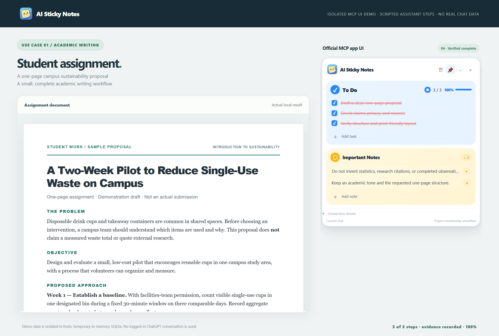
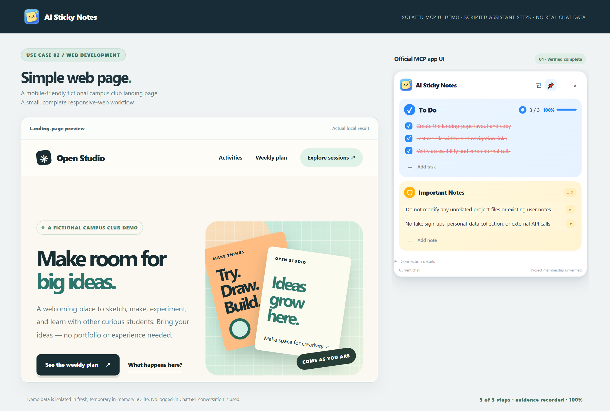

# AI Sticky Notes

**The colleague-test package is downloadable. Download → install → connect your own AI account → report your results.**

## [Download Windows x64 testing ZIP — v0.4.29-beta.1](https://github.com/innocirclelabs-hub/ai-sticky-notes/releases/download/v0.4.29-beta.1/AI-Sticky-Notes-Windows-v0.4.29-beta.1.zip)

[Release / checksum](https://github.com/innocirclelabs-hub/ai-sticky-notes/releases/tag/v0.4.29-beta.1) · [Install and connect](INSTALL.md) · [Install with an AI assistant](INSTALL_WITH_AI.md) · [Testing checklist](TEST_CHECKLIST.md) · [Continue in a new conversation](CONTINUATION.md) · [First use](FIRST_RUN.md)

Extract **AI-Sticky-Notes-Windows-v0.4.29-beta.1.zip**, then run **AI-Sticky-Notes-Setup.exe**. This package includes the Chrome extension, compiled local note engine, Node runtime, official OpenAI tunnel runtime, local diagnostic, and setup guides. **Do not download the automatic Source code ZIP as the installer.**

Your own supported ChatGPT/OpenAI account, tunnel authorization, runtime credential and Chrome extension approval remain necessary. No publisher keys, tunnel profile or existing notes are supplied. The setup helper accepts a credential reference, not the key itself; the official tunnel client handles it. This is a **prerelease for invited installation and functionality testing**, not a production-readiness claim. [Testing permission](EVALUATION_PERMISSION.md).

## One floating note, not two task cards

The full task UI appears only as a movable yellow overlay above the ChatGPT Chrome page. Asking ChatGPT to open AI Sticky Notes uses a small temporary pairing notice to transfer the conversation's one-use proof; it is not a second editable note. The bundled extension is required for free movement. Setup has a single Open ChatGPT + copy first request action. [First-use steps](FIRST_RUN.md).

## Keep tasks and rules visible

AI Sticky Notes attaches a movable note to existing ChatGPT conversations. Tasks and persistent must-follow rules stay separate. Review an entire proposed work plan once; actual AI tools can read the approved notes and record evidence-backed completion. Completed tasks retain red strikethroughs.

Each approved job has its own title, large completion check, progress and independent fold control. A completed **7/7 · 100%** group stays distinct from the next **0/3 · 0%** job. Archive completed groups, save Markdown, or use one-confirm recoverable Trash without removing guardrails.

Drag, resize, fold and reopen; use Korean/English interface labels without translating note text. Optional native Picture-in-Picture is browser-controlled. Notes are private by default; explicit same-project sharing can be revoked. Revocation cannot erase text already sent in an earlier conversation message.

Routine note access uses actual MCP tool reads rather than unsolicited note-summary attachments to the message composer. Visible notes alone do not guarantee AI compliance or prove it has read them.

## What is verified, and what you test

The packaged Windows runtime passed its isolated local diagnostic, including authentication rejection, fresh SQLite startup, note read-back, separate-session privacy, plan approval/completion and restart restoration. The setup window was actually opened. Product-source regression evidence and earlier real maintainer-side Chrome/share tests are separate from this package test.

**Your own external account/PC acceptance is the purpose of this release and remains for you to run.** A READY tunnel, successful local diagnostic or rendered note is not automatically a live AI integration PASS. Use [the checklist](TEST_CHECKLIST.md) and [troubleshooting](TROUBLESHOOTING.md).

## Continue without resetting progress

When a conversation reaches its limit, select **Continue previous work** in a paired conversation in the same verified project. Review one group and confirm once. Its IDs, progress, completion evidence and applicable rules are preserved; unrelated work remains separate. The old conversation becomes read-only for that group. No unsolicited composer attachment is used. [Steps and limits](CONTINUATION.md).

## Examples

| Assignment | Responsive webpage |
|---|---|
|  |  |
| [Assignment walkthrough](USE_CASE_01_STUDENT_ASSIGNMENT.md) | [Webpage walkthrough](USE_CASE_02_SIMPLE_WEB_PAGE.md) |

These sample images are scripted isolated product-UI demonstrations, not proof of autonomous execution in a logged-in account. [Provenance](SCREENSHOTS.md).

## Scope and rights

**Current test platform:** Windows 10/11 x64, desktop Chrome and supported ChatGPT custom MCP/tunnel accounts. Codex, mobile, other operating systems and Chrome Web Store distribution are not included.

First-party source remains private. The download contains compiled engine bytecode and required inspectable browser-side JavaScript, not the original backend source tree. Compiled code is not promised to be reverse-engineering-proof. Third-party components retain their own [licenses](THIRD_PARTY_NOTICES.md). [Privacy](PRIVACY.md) · [Rights](RIGHTS_AND_SCOPE.md).

Use [Issues](https://github.com/innocirclelabs-hub/ai-sticky-notes/issues/new/choose) for redacted test results, bugs and feature requests. Security issues belong in [private vulnerability reporting](https://github.com/innocirclelabs-hub/ai-sticky-notes/security/advisories/new). Never upload key files, databases, tunnel identifiers or private conversations.
