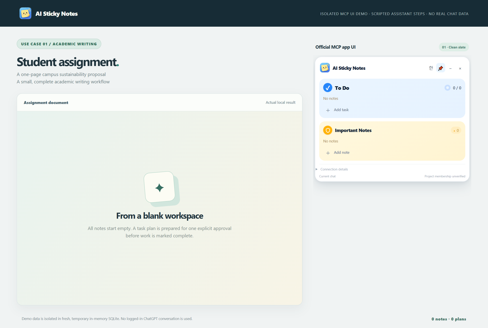
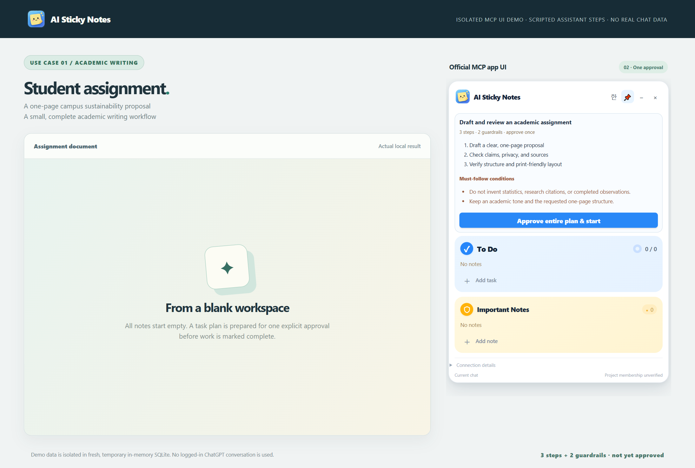
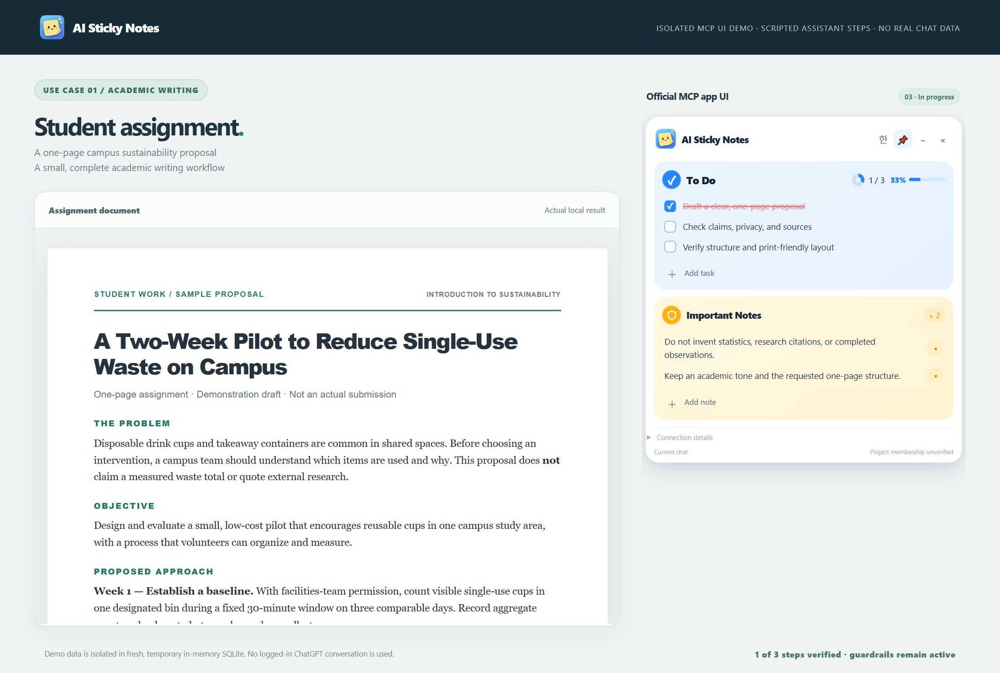
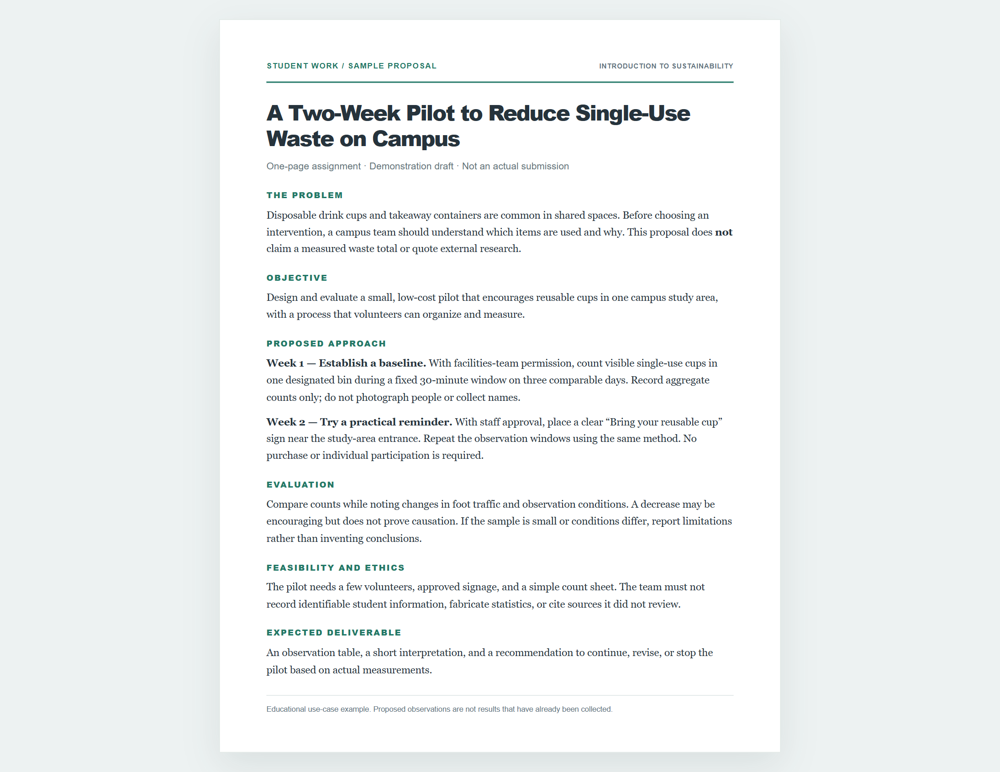
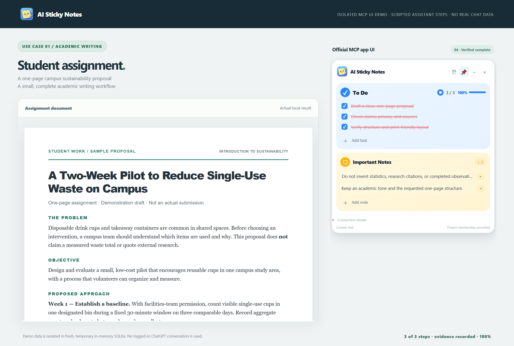

# Use Case 01 — University Assignment

**Task:** Prepare a sample one-page proposal on reducing disposable cups on campus.

## User request

> Write a concise university assignment proposing a two-week campus waste-reduction pilot. Include the problem, objective, approach, evaluation and ethical limitations. Do not invent data or citations.

## Step 1 — Start clean

The isolated demonstration starts with **0 notes and 0 plans**, rather than deleting or reusing any existing ChatGPT notes.

## Step 2 — Review one plan

**Tasks:** (1) draft the proposal, (2) review claims and privacy, (3) verify layout.

**Must-follow rules:** (1) do not fabricate statistics, citations or completed observations, (2) retain an academic tone and one-page structure.

The whole plan is approved with **one button click**.

## Step 3 — Work, verify, complete

The resulting academic draft describes a hypothetical two-week reusable-cup pilot and makes clear that measurements have not yet been collected. The demonstration checks required headings, disclaimer text, source claims and print layout before advancing each step.

## Result — 100%

Three tasks are completed with recorded evidence and red strikethrough. Both must-follow rules remain intact, with per-card folding available.

**Verified in this isolated test:** 0 initial notes, 1 plan, 1 approval click, 3 evidence-backed completed tasks, 2 persistent constraints and 100% progress.

**Provenance:** Real MCP app UI and real rendered sample document, driven by a deterministic local test. **Not** a logged-in ChatGPT conversation or proof of autonomous AI calls.
