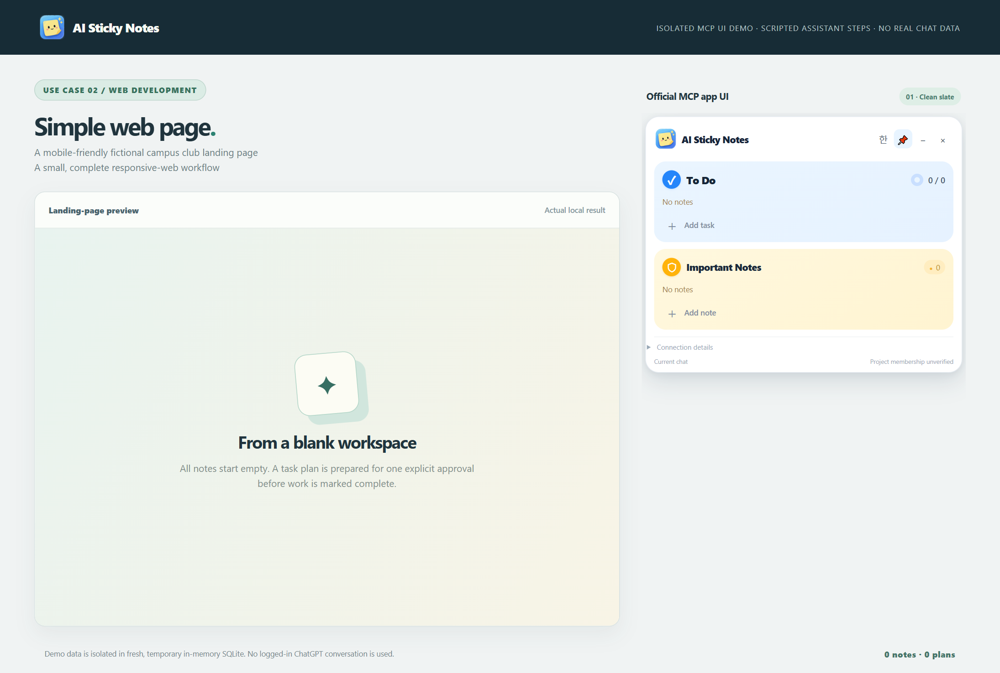
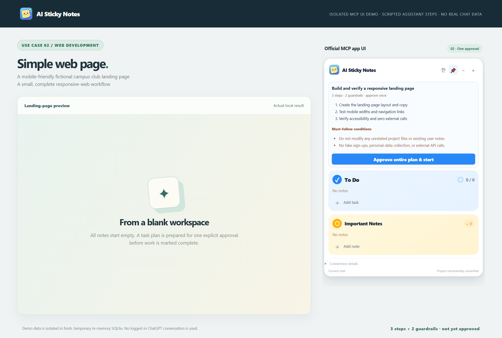
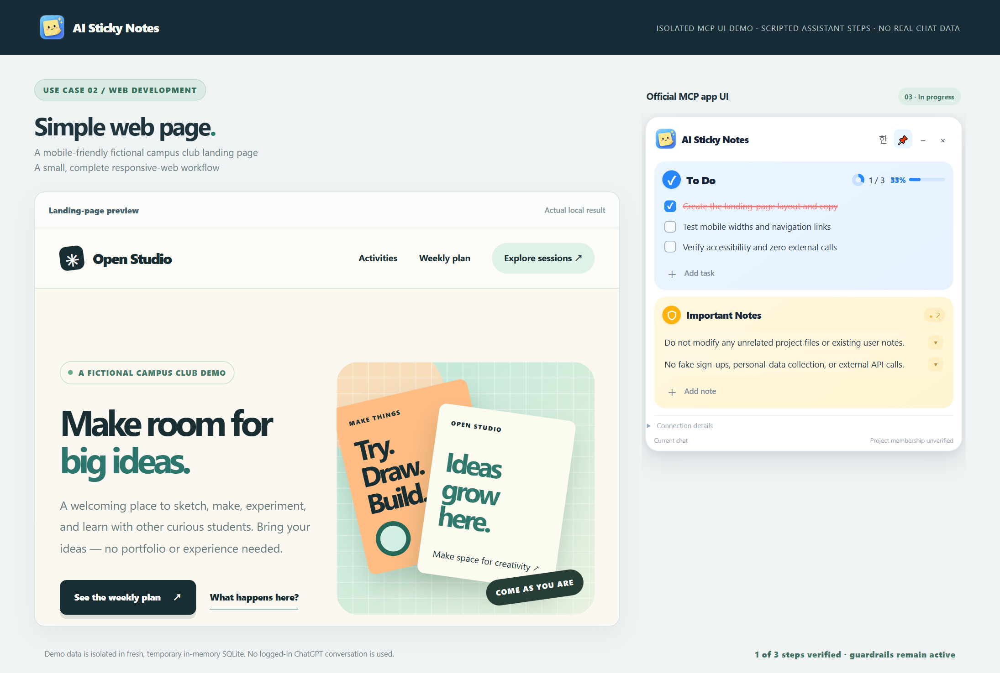
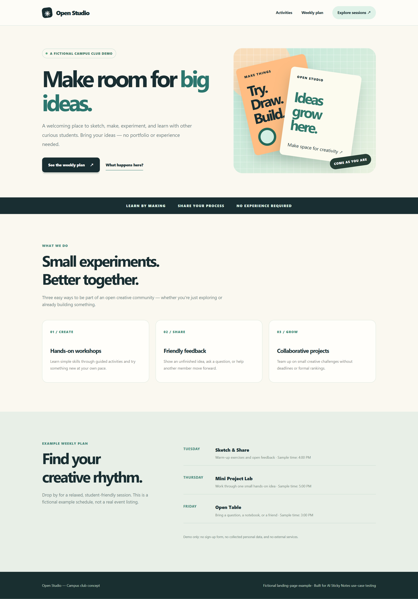
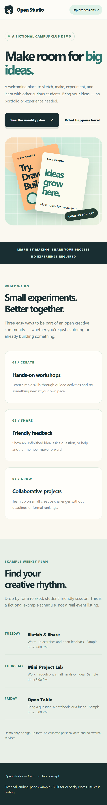
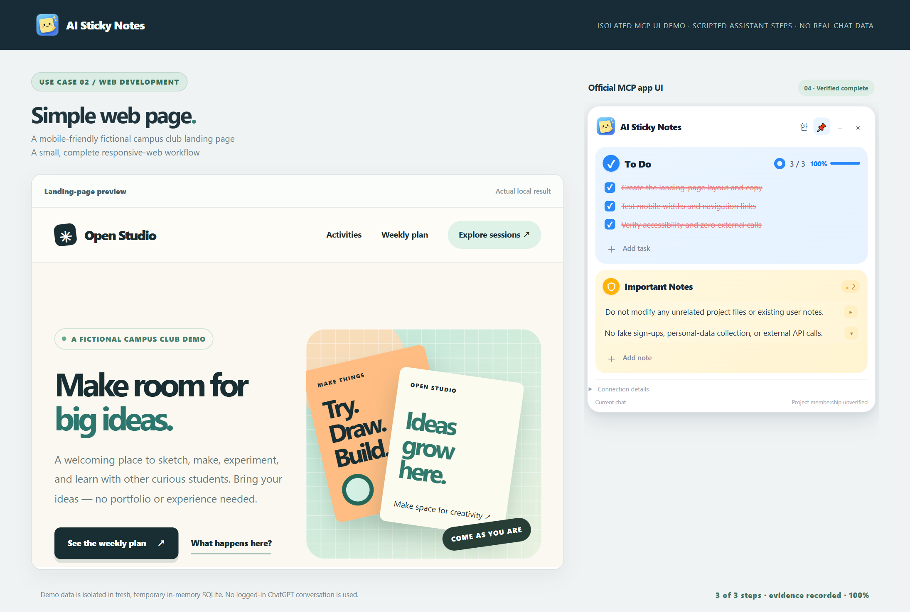

# Use Case 02 — Small Responsive Web Page

**Task:** Build an English landing page for a fictional student creative club.

## User request

> Design a responsive club landing page with a hero, activities and an example weekly schedule. Avoid external services, fake registrations and personal-data collection.

## Step 1 — Start clean

The second scenario starts in a **different, empty test session**: no inherited university-assignment notes and no user data.

## Step 2 — Review one plan

**Tasks:** (1) build the page, (2) check mobile widths and navigation, (3) validate accessibility and network behavior.

**Must-follow rules:** (1) leave unrelated files and notes untouched, (2) create no registration forms or external API calls.

The complete plan is confirmed with **one approval click**, not separate approvals for five notes.

## Step 3 — Build and verify

The result is a fictional **Open Studio** club landing page. The test inspects the actual rendered page at **320, 375, 390, 768 and 1440px**, verifies internal navigation targets, checks zero horizontal overflow and confirms that no external network requests are made.

**Desktop output**

**Mobile output**

## Result — 100%

The page checks pass, all three tasks have completion evidence and red strikethrough, and both constraints stay active.

**Verified in this isolated test:** 0 initial notes, 1 plan, 1 approval click, 3 completed tasks with evidence, 2 persistent constraints, and 100% progress. No login, signup or customer data.

**Provenance:** Screenshots are actual browser captures of a scripted, isolated MCP UI demonstration, **not** a live ChatGPT LLM session.
